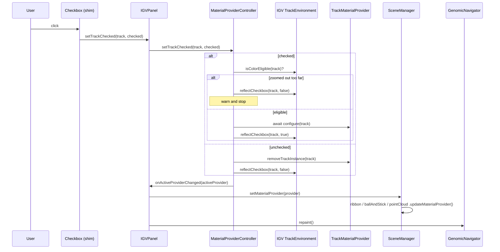

# Architecture: the track material-provider checkbox

How a per-track checkbox in IGV's axis column lets genomic track data color the 3D
structure.

> **Refreshed 2026-11.** Spacewalk owns all of this now. The checkbox is injected by a
> Spacewalk shim (igv.js is unmodified), and the checked-track state machine lives in
> `MaterialProviderController` (PR #53), not in `IGVPanel`. The viewer, not IGV, owns the
> current material provider; IGV plugs one in through `sceneManager.setMaterialProvider()`.

---

## The pieces

| Piece | File | Owns |
|---|---|---|
| Checkbox shim | `src/igvTrackMaterialProviderShim.js` | Injects one `<input type=checkbox>` into each track's axis div (skips `ruler`, `sequence`, `ideogram`). Re-injects on `trackorderchanged`. On `change` it calls `igvPanel.setTrackChecked(track, checked)`. Stores the input on `trackView.materialProviderInput`. |
| `IGVPanel` | `src/IGVPanel.js` | Builds the controller and wires its `onActiveProviderChanged` callback. Installs the shim and the `trackremoved` listener in `configureMouseHandlers()`. Delegates `setTrackChecked`, `getSessionState`, `restoreSessionState`. |
| `MaterialProviderController` | `src/materialProviderController.js` | The checked-track set (`Map` of `name\|index` ids), the binary active-provider switch, the zoom gate, and session serialize/restore. Testable: it only talks to IGV through the TrackEnvironment port. |
| TrackEnvironment port | `src/igvTrackEnvironment.js` | The production adapter: `tracks()`, `idFor()`, `isColorEligible()` (zoom gate), `isLoading()`, `reflectCheckbox()`, `isCheckedInUI()`. |
| Track id | `src/trackId.js` | `name\|index` ids, so two tracks with the same name stay distinct. |
| `TrackMaterialProvider` | `src/trackMaterialProvider.js` | `configure(track)` samples features over the ensemble's genomic extents and builds a per-track color list; multiple tracks blend in LAB space. `colorForInterpolant(t)` is what the renderers read. Constructed by `viewer.js`. |
| Signal port | `src/sceneManager.js` `setMaterialProvider()` | Makes the provider current and fans out to ribbon / ball-and-stick / point cloud. The navigator strip reads `sceneManager.materialProvider` on its own `repaint()`. |

The active provider is a fixed binary switch, not a registry: **any checked track → the
track provider; none → the color ramp.**

---

## Checking a track

---

## Other paths into the same state

- **Track removed from IGV** (`trackremoved`): `MaterialProviderController.removeTrack(track)`.
  By then the track is gone from `browser.trackViews`, so its `name|index` id can't be
  recomputed. It removes by name prefix instead, calls `trackMaterialProvider.removeTrack(name)`,
  and re-evaluates the active provider.
- **New ensemble loaded:**
  - `EnsembleIngestionController` calls `trackMaterialProvider.clearAllTracks()`. The cached color
    lists are keyed to the old genomic extent, and a length mismatch crashes the blend.
  - It then sets the color ramp as the viewer's provider and repaints, before it announces
    `DidLoadEnsembleFile`.
  - `IGVPanel` hears that event and calls `unsetDataMaterialProviderCheckbox()` (`src/utils/utils.js`)
    synchronously. This unticks every box and clears the controller before `loadGenome` removes
    tracks, so `trackremoved` can't re-select an empty track provider.
- **Session save/restore:**
  - `getSessionState()` returns the reconciled checked ids, or `'none'`.
  - On restore, `sessionServices` first clears the controller and the track provider, then
    calls `restoreSessionState()`. That re-checks each track through `setTrackChecked()` and
    skips tracks that are still loading.
  - The legacy session format (bare track names) restores the first track with each name.
- **Color map change:** `SceneManager` re-applies the color ramp on `DidChangeColorMap`, but
  only while the ramp is the active provider.

---

## Things to watch

- The zoom gate is real. A checkbox ticked while IGV is zoomed out reverts itself.
- `serialize()` recovers ticked boxes whose recorded id went stale after a track reorder.
  Keep that in mind before simplifying it.
- The viewer-only page (`viewer.html`) has no IGV, so it has none of this. Only the color
  ramp drives it.
