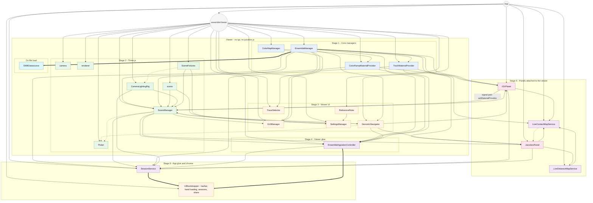

# Wiring Diagram — App construction & dependency injection

How the running system is assembled and how dependencies reach each module. Assembly is in two halves (#109): `assembleViewer()` in `src/viewer.js` builds the 3D viewer, whole on its own and with no `igv` or `juicebox.js` import; `App` calls it, then builds the app chrome and attaches the companion panels (IGV, Juicebox) to the viewer through the ports. Every dependency is explicit; nothing reaches into `app.js` to grab a singleton.

> 📐 **Standalone SVG addendum:** [`wiring-diagram.svg`](./wiring-diagram.svg) — open in a browser or image viewer to pan/zoom at full resolution. The inline render below is the same diagram but constrained to the document's column width. Regenerate via `npx -y @mermaid-js/mermaid-cli -i development-notes/architecture/wiring-diagram.mmd -o development-notes/architecture/wiring-diagram.svg -b transparent` after editing [`wiring-diagram.mmd`](./wiring-diagram.mmd).

**Conventions:**
- **Solid arrow (`-->`)** — constructor injection (dep passed via `new X({...})`)
- **Dashed arrow (`-.->`)** — late-bound dependency via `wireDependencies({...})` setter
- **Thick arrow (`==>`)** — runtime/on-demand construction or lazy-getter resolution
- **Labelled arrow (`-- port -->`)** — a runtime call across a port (see `CONTEXT.md`, **Port**)

The arrow points *from supplier to consumer*: `EM --> SM` means "EnsembleManager is passed to SceneManager."

Modules are grouped by lifecycle stage. `App.initialize()` walks them in order top → bottom — stages 1–4 inside `assembleViewer()`, then 5–6 — and each stage's modules can only depend on what's already been built. The **Viewer** box is the carve-out boundary: nothing inside it depends on anything outside it.

**Edge legend recap:** dashed arrows into Picker (`GN -.-> Picker`, `SM -.-> Picker`) read as "Picker receives genomicNavigator and sceneManager via `picker.wireDependencies({...})`"; `GN -.-> SM` is `sceneManager.createHighlighters({...})`. The thick arrows into the app chrome denote that its file-load, session, and share widgets reach `EnsembleIngestionController` and `SessionService` through lazy-getter thunks, because they are wired before `SessionService` exists. The one labelled arrow is the signal port: IGV's `MaterialProviderController` plugs the active material provider into the viewer by calling `sceneManager.setMaterialProvider()`.

## What the diagram is saying

- **The viewer is whole on its own.** `assembleViewer()` builds scene, ensemble manager, ingestion, visualizations, navigator, picker, camera and lighting, and fixtures, and returns a `Viewer` that owns the render loop and resize handling. `src/viewer.test.js` walks its import graph and fails if `igv` or `juicebox.js` is reachable. A viewer-only page calls `assembleViewer()` and stops.
- **App attaches, it doesn't reach in.** The panels receive viewer parts by constructor injection and talk back through the ports; no arrow points from a panel into the Viewer box except the signal port.
- **Layered, not tangled.** Stages are strictly ordered: each stage's modules can only receive deps from earlier stages.
- **Late-bound deps are explicit.** When a module is constructed before its dependency exists (`Picker` needs `genomicNavigator`, which needs `SceneManager`), the dashed `wireDependencies` arrow shows that — not a hidden module import.
- **Lazy getters where callbacks outlive wiring.** `spacewalkFileLoadWidgetServices` and `shareWidgets` wire their modal handlers before `SessionService` exists, so they receive thunks that resolve at user-click time.

## What this diagram is **not**

- Not a class diagram — it does not enumerate methods or fields.
- Not a runtime call graph — see [`runtime-sequence-drag-drop.md`](./runtime-sequence-drag-drop.md) for the "user drops a `.sw` file" flow.
- Not exhaustive — minor utility imports (e.g. `colorUtils`, `mathUtils`) are pure functions and intentionally omitted.

## Updating this diagram

When you add a new module or rewire an existing one:
1. Decide which side of the carve-out it is on. If it is 3D and only 3D, it is built in `assembleViewer()` and must not import `igv` or `juicebox.js`; otherwise it belongs to `App`.
2. Find the stage it belongs to (or add one if a genuinely new layer).
3. Add the box + classify it (`core` / `threejs` / `ui` / `panel` / `service` / `datasource`).
4. Add solid arrows for constructor injection, dashed for `wireDependencies`, dotted for lazy thunks.
5. If you find yourself reaching for `import { foo } from './app.js'` to read shared state, **stop** — that pattern was removed in PRs #42–#45. Pass it through.
